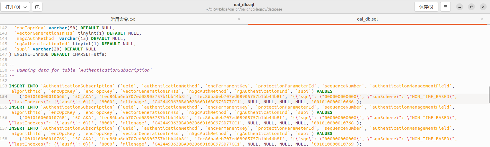
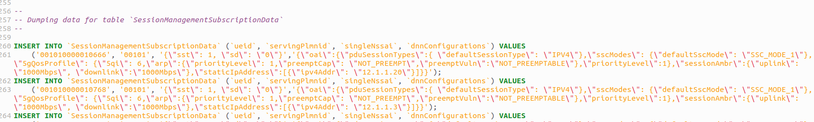
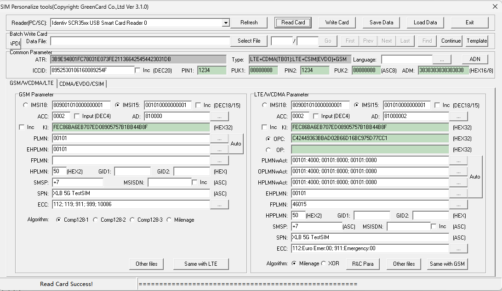
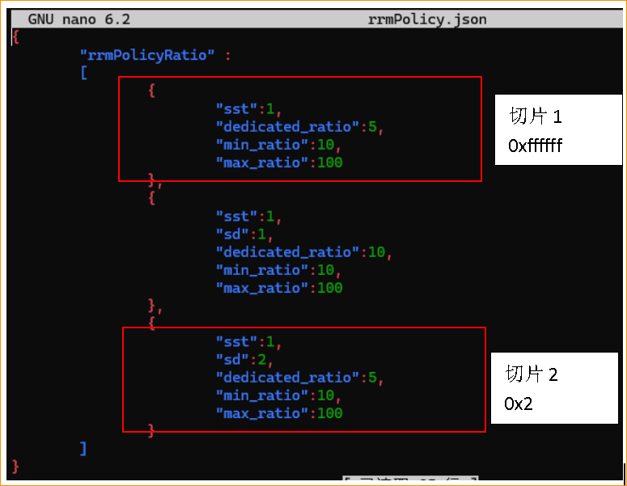
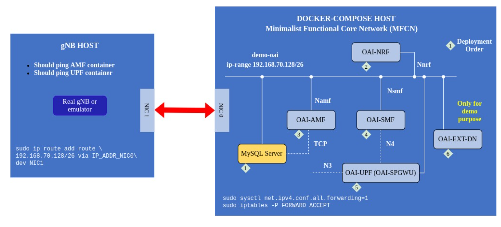

# 端到端平台搭建教程
# 目录：

- [目录](#目录：)
- [1. 部署场景](#1-部署场景)
  - [1.1 OAI 最低要求](#11-OAI-最低要求)
  - [1.2. 测试平台配置](#12-测试平台配置)
- [2. 核心网-OAI CN5G](#2核心网-OAI-CN5G)
  - [2.1 OAI CN5G-预先环境准备](#21-OAI-CN5G-预先环境准备)
  - [2.2 OAI CN5G-安装](#22-OAI-CN5G-安装)
  - [2.3 OAI CN5G-配置](#23-OAI-CN5G-配置)
  - [2.4 OAI CN5G-数据库添加相关UE的ISIM信息](#24-OAI-CN5G-数据库添加相关UE的ISIM信息)
  - [2.5 OAI CN5G-开启](#25-OAI-CN5G-开启)
  - [2.6 OAI CN5G-停止](#25-OAI-CN5G-停止)
- [3. 基站-OAI gNB5G](#3-基站-OAI-gNB5G)
  - [3.1 OAI gNB5G-预先环境准备](#31-OAI-gNB5G-预先环境准备)
  - [3.2 OAI gNB5G-安装](#32-OAI-gNB5G-安装)
  - [3.3 OAI gNB5G-配置](#33-OAI-gNB5G-配置)
- [4. Flexric-OAI](#4-Flexric-OAI)
  - [4.1 Flexric-OAI-安装和运行](#41-Flexric-OAI-安装和运行)
  - [4.2 Flexric-OAI-xApp](#42-Flexric-OAI-xApp)
  - [4.2 Flexric-OAI-xApp-重新设计编译](#43-Flexric-OAI-xApp-重新设计编译)
- [5. 终端-UE](#5-终端-UE)
  - [5.1 商用 UE-设置和配置](#51-商用-UE-设置和配置)
  - [5.2 软仿OAI UE-设置和配置](#52-软仿OAI-UE-设置和配置)
- [6. 运行5G端到端网络](#6-运行5G-端到端网络)
  - [6.1 OAI CN5G-运行](#61-OAI-CN5G-运行)
  - [6.2 OAI gNB-运行](#62-OAI-gNB-运行)
    - [6.2.1 USRP B210](#621-USRP-B210)
    - [6.2.2 RFSIMULATOR模式](#622-RFSIMULATOR-模式)
  - [6.3 终端 UE-运行](#63-终端-UE-运行)
    - [6.3.1 商用 UE-运行](#631-商用-UE-运行)
    - [6.3.2 软仿OAI UE-运行](#632-软仿OAI-UE-运行)
- [7. 故障排查、调试与高级配置](#7-故障排查、调试与高级配置)
  - [7.1 UHD 调试](#71-UHD-调试)
  - [7.2 UE 上看不到网络](#72-UE-上看不到网络)
  - [7.3 UE 无法上网masq 不生效](#73-UE-无法上网masq-不生效)
- [8. 真实环境部署网络注意事项](#8-真实环境部署网络注意事项)


# 部署教程

端到端网络切片主要分为核心网、接入网、近实时基站控制器Flexric。目前都是采用OAI的开源代码。
在本教程中：核心网部署在Ubuntu 22.04，ip为192.168.70.1；基站部署在20.4，ip为192.168.70.3；基站连接USRPb210；基站和核心网通过网线连接；UE终端使用xiaomi 13。


```
git clone https://github.com/wineslab/ORANSlice.git
```

本指南提供使用开源软件方案与商用现货（COTS）硬件部署端到端 5G SA 网络的分步说明。

# <a name='Deployment Scenario'></a>1. 部署场景
在本教程中，我们将介绍如何使用 OAI CN5G、OAI gNB 和 COTS UE 配置并运行端到端 5G 系统。

## <a name='OAIminimumrequirements'></a>1.1 OAI 最低要求
- 用于 OAI CN5G 和 OAI gNB 的笔记本/台式机/服务器
    - 操作系统：[Ubuntu 22.04 LTS](https://releases.ubuntu.com/22.04/ubuntu-22.04.1-desktop-amd64.iso)
    - CPU：8 核 x86_64 @ 3.5 GHz
    - 内存：32 GB
- 用于 UE 的笔记本电脑
    - 操作系统：Microsoft Windows 10 x64
    - CPU：4 核 x86_64
    - 内存：8 GB
    - Quectel 的 Windows 驱动版本**必须**不低于 **2.2.4**
- [USRP B210](https://www.ettus.com/all-products/ub210-kit/)、[USRP N300](https://www.ettus.com/all-products/USRP-N300/) 或 [USRP X300](https://www.ettus.com/all-products/x300-kit/)
    - 请确认 USRP 所连接的网络接口，并相应更新 gNB 配置文件
- Quectel RM500Q
    - 模组、M.2 转 USB 适配器、天线与 SIM 卡
    - Quectel 固件版本**必须**不低于 **RM500QGLABR11A06M4G**

## <a name='testbedconfiguration'></a>1.2. 测试平台配置
- 3 台台式机用于 OAI CN5G、OAI gNB 与模拟 UE
    - 操作系统：[Ubuntu 22.04 LTS](https://releases.ubuntu.com/22.04/ubuntu-22.04.1-desktop-amd64.iso)
    - CPU：i9-10980XE @ 3.5 GHz
    - 内存：32 GB
- [USRP X310](https://www.ettus.com/all-products/x310-kit/)
    - 请确认 USRP 所连接的网络接口，并相应更新 gNB 配置文件
- Xiaomi 13（UE）
    - Android 13（Tiramisu）
    - 5G Sub-6：频段 n1/2/3/5/7/8/12/20/25/28/30/38/40/41/48/66/71/77/78
    - Sysmocomm sysmoISIM-SJA2 可编程 SIM


# <a id='核心网-OAI CN5G'></a>2.核心网-OAI CN5G

## <a name='OAI CN5G-预先环境准备'></a>2.1 OAI CN5G-预先环境准备

dokcer环境安装，国内环境下载见[docker](https://www.cnblogs.com/chengmf/p/13122013.html)；docker镜像源[docker_mirrors](https://www.coderjia.cn/archives/dba3f94c-a021-468a-8ac6-e840f85867ea)

```bash
sudo apt install -y git net-tools putty

# https://docs.docker.com/engine/install/ubuntu/
sudo apt install -y ca-certificates curl gnupg
sudo install -m 0755 -d /etc/apt/keyrings
curl -fsSL https://download.docker.com/linux/ubuntu/gpg | sudo gpg --dearmor -o /etc/apt/keyrings/docker.gpg
sudo chmod a+r /etc/apt/keyrings/docker.gpg
echo "deb [arch="$(dpkg --print-architecture)" signed-by=/etc/apt/keyrings/docker.gpg] https://download.docker.com/linux/ubuntu "$(. /etc/os-release && echo "$VERSION_CODENAME")" stable" | sudo tee /etc/apt/sources.list.d/docker.list > /dev/null
sudo apt update
sudo apt install -y docker-ce docker-ce-cli containerd.io docker-buildx-plugin docker-compose-plugin

# 将用户名加入到docker组，以便后续不用sudo运行docker
sudo usermod -a -G docker $(whoami)
reboot
```
## <a name='OAI CN5G-安装'></a>2.2 OAI CN5G-安装

详细在oai_cn[ORANSlice](https://github.com/wineslab/ORANSlice/tree/main/oai_cn)仓库有OAIv1.5.1-legacy版本和最新的版本develop。

以上主要参考官网的来制作基础版docker-compose，官网仓库：[OAI-CN](https://gitlab.eurecom.fr/oai/cn5g/oai-cn5g-fed/-/blob/master/docs/DEPLOY_HOME.md)
大致分为：
1. 一键起基础版5GC：包含UPF((SPGWU))、NRF、AMF、SMF、AUSF、UDM、UDR、MySQL 等核心网功能，使用 docker-compose-basic-nrf.yaml [OAI1](https://gitlab.eurecom.fr/oai/cn5g/oai-cn5g-fed/-/blob/master/docs/DEPLOY_SA5G_BASIC_DEPLOYMENT.md)
2. 通过 Helm 在 Kubernetes 上部署 OAI 5GC（而不是 docker-compose），适合云原生集群。[OAI2](https://gitlab.eurecom.fr/oai/cn5g/oai-cn5g-fed/-/blob/master/docs/DEPLOY_SA5G_HC.md)
3. 配置并验证网络切片（多个基站，多个 S-NSSAI / DNN，跨 SMF/UPF 的策略与数据面隔离）。[OAI3](https://gitlab.eurecom.fr/oai/cn5g/oai-cn5g-fed/-/blob/master/docs/DEPLOY_SA5G_SLICING.md)
4. 进行核心网docker内部开发详细教程。[OAI4](https://gitlab.eurecom.fr/oai/cn5g/oai-cn5g-fed/-/blob/master/docs/DEBUG_5G_CORE.md)

## <a name='OAI CN5G-配置'></a>2.3 OAI CN5G-配置

去到对应的config配置文件夹，修改核心网修改对于的yaml文件
```
cd ~/oai-cn5g
cd docker-compose/conf
sudo nano <conf_file>
```
为正确配置核心，需要执行以下步骤：

 * 在 AMF 配置文件中，NGAP addr、MCC、MNC、TAC 和 S-NSSAI（SST 和 SD）应与 gNB 配置文件中看到的相同。
 * 在其余核心网功能配置文件中，需要配置正确的 AMF addr，并且应与 gNB 配置文件中看到的相同。
 * 需要配置 APN/DNN，使其与 UE 中的 APN/DNN 相同，并将其设置为 IPv4，而不是 IPv4/6 或 IPv6。
 * 需要通过oai_db2.sql数据库文件将 ISIM 凭据添加到订阅者列表中。

## <a name='OAI CN5G-数据库添加相关UE的ISIM信息'></a>2.4 OAI CN5G-数据库添加相关UE的ISIM信息

同时需要到核心对应的数据库oai_db.sql修改（不同版本对应着不同名称数据库），保持和ue的信息对齐。
```
cd ~/oai-cn5g
cd docker-compose/database/
sudo nano oai_db.sql
```
如下图在数据库中加入关于UE的ISIM：
```
INSERT INTO `AuthenticationSubscription` (`ueid`, `authenticationMethod`, `encPermanentKey`, `protectionParameterId`, `sequenceNumber`, `authenticationManagementField`, `algorithmId`, `encOpcKey`, `encTopcKey`, `vectorGenerationInHss`, `n5gcAuthMethod`, `rgAuthenticationInd`, `supi`) VALUES
('001010000060591', '5G_AKA', '18E8DE5BA04A8D910B010D298672BCE0', '18E8DE5BA04A8D910B010D298672BCE0', '{\"sqn\": \"000000000020\", \"sqnScheme\": \"NON_TIME_BASED\", \"lastIndexes\": {\"ausf\": 0}}', '8000', 'milenage', 'B71C0607B0A5AE6E3657FEE846579991', NULL, NULL, NULL, NULL, '001010000060591');
```

如下图在数据库中加入关于UE的上网信息APN：
这个值需要注意一下，这个值需要是核心网的中的SMF组件中的DNN 列表中的一个，可以通过以下的两个文件来查看。
```
INSERT INTO `SessionManagementSubscriptionData` (`ueid`, `servingPlmnid`, `singleNssai`, `dnnConfigurations`) VALUES
('208990000007487', '20895', '{\"sst\": 222, \"sd\": \"123\"}','{\"default\":{\"pduSessionTypes\":{ \"defaultSessionType\": \"IPV4\"},\"sscModes\": {\"defaultSscMode\": \"SSC_MODE_1\"},\"5gQosProfile\": {\"5qi\": 6,\"arp\":{\"priorityLevel\": 1,\"preemptCap\": \"NOT_PREEMPT\",\"preemptVuln\":\"NOT_PREEMPTABLE\"},\"priorityLevel\":1},\"sessionAmbr\":{\"uplink\":\"100Mbps\", \"downlink\":\"100Mbps\"},\"staticIpAddress\":[{\"ipv4Addr\": \"12.1.1.4\"}]}}');
```


## <a name='OAI CN5G-开启'></a>2.5 OAI CN5G-开启
```
cd ~/oai-cn5g
docker compose up -d
```
## <a name='OAI CN5G-停止'></a>2.6 OAI CN5G-停止

```
cd ~/oai-cn5g
docker compose down
```

# <a id='基站-OAI gNB5G'></a>3. 基站-OAI gNB5G

## <a name='OAI gNB5G-预先环境准备'></a>3.1 OAI gNB5G-预先环境准备

为E2Agent安装protobuf-c
```
sudo apt-get update
sudo apt install protobuf-compiler
sudo apt install libprotoc-dev
git clone https://github.com/protobuf-c/protobuf-c && cd protobuf-c/ && ./autogen.sh && ./configure && make && sudo make install && sudo ldconfig
```
安装硬件usrp相关环境
注意gcc版本，Ubuntu 22.04.1 默认使用 gcc-11，而所使用的 FlexRIC 版本只能使用 gcc-10 构建。一种切换 gcc 版本的方法是使用 update-alternatives 工具，或者您可以降级/安装 gcc-10 版本。cmake版本最好是最新或者3.22的版本，3.16版本可能会出错误。
```
sudo apt install -y libboost-all-dev libusb-1.0-0-dev doxygen python3-docutils python3-mako python3-numpy python3-requests python3-ruamel.yaml python3-setuptools cmake build-essential
```
构建USRP UHD
```
git clone https://github.com/EttusResearch/uhd.git ~/uhd
cd ~/uhd
git checkout v4.4.0.0
cd host
mkdir build
cd build
cmake ../
make -j $(nproc)
make test # This step is optional
sudo make install
sudo ldconfig
sudo uhd_images_downloader
```
## <a name='OAI gNB5G-安装'></a>3.2 OAI gNB5G-安装
在ORANSlice项目oai_ran中的库[Github Repo](.....)和官网[Github Repo](https://gitlab.eurecom.fr/oai/openairinterface5g)相同，构建步骤如下：
```
# Get openairinterface5g source code
git clone https://gitlab.eurecom.fr/oai/openairinterface5g.git ~/openairinterface5g
cd ~/openairinterface5g
#切换最新版本
git checkout develop 

# Install OAI dependencies
cd ~/openairinterface5g/cmake_targets
./build_oai -I

# Build OAI gNB
sudo apt install -y libforms-dev libforms-bin
./build_oai -I -w USRP --ninja --nrUE --gNB --build-e2 --build-lib "nrscope" -C
#如果后期需要和flexric连接，必须要安装E2Agent，然后cmake版本最好设置为3.22以上（https://gitlab.eurecom.fr/mosaic5g/flexric#2-flexric-installation）（https://gitlab.eurecom.fr/oai/openairinterface5g/-/blob/develop/openair2/E2AP/README.md#221-case-1-oai-ran-and-flexric-on-the-same-machine）
（https://whimsical.com/flexric-J2a1rCY3dJ5oqMvTmLLnNR）
```
build_oai参数说明：

 * -w USRP：构建软件以使用 USRP 作为无线电接口，同时编译rfsim
 * --ninja：告诉编译器使用 Ninja 构建系统
 * --nrUE：构建新的无线电用户设备
 * --gNB：构建新的无线电 gNB
 * --build-lib all：构建所有其他库
 * --build-e2：E2Agent接口，用于和flexric连接
 * -c：清除以前的构建
注意：观测信号波形的GUI界面是OAI里面自带的，需要在Build gNB时加入nrscope选项。
oai_ran官网步骤[Original](https://gitlab.eurecom.fr/oai/openairinterface5g/-/blob/NR_UE_multi_pdu/doc/NR_SA_Tutorial_OAI_nrUE.md)

## <a name='OAI gNB5G-配置'></a>3.3 OAI gNB5G-配置
在 CONF 文件夹中运行 gNB 之前，您需要根据所需的设置调整 gNB 配置文件。它包含适用于不同 USRP 设备、带宽和频段的多个文件，可以根据您的特定设置进行调整。我们将一些自定义配置文件包含在 conf-files 文件夹中以供参考。
```
#gNB configuration files
cd ~/openairinterface5g
cd targets/PROJECTS/GENERIC-NR-5GC/CONF/
sudo nano <conf_file>
```
* MCC、MNC、TAC （tracking_area_code） 和 S-NSSAI （SST 和 SD） 参数应与核心配置文件中的值相同。
* 要配置核心和 gNB 之间的连接，您需要将正确的 AMF 参数 （amf_ip_address） 设置为 AMF 的地址和正确的网络接口 （NETWORK_INTERFACES）。
要与Flexric连接，必须配置E2 节点（gNB-mono、DU、CU、CU-UP、CU-CP）配置文件必须包含该部分。
```
e2_agent = {
  near_ric_ip_addr = "127.0.0.1";
  sm_dir = "/usr/local/lib/flexric/";
}
```
# <a id='Flexric-OAI'></a>4. Flexric-OAI

## <a name='Flexric-OAI-安装和运行'></a>4.1 Flexric-OAI-安装和运行
原来步骤Near-Real-Time RIC(FlexRIC)[guide2](https://gitlab.eurecom.fr/mosaic5g/flexric#2-flexric-installation)(https://whimsical.com/flexric-J2a1rCY3dJ5oqMvTmLLnNR)(https://gitlab.eurecom.fr/oai/openairinterface5g/-/blob/develop/openair2/E2AP/README.md)

自动化安装脚本(https://github.com/usnistgov/O-RAN-Testbed-Automation/tree/main/OpenAirInterface_Testbed/RAN_Intelligent_Controllers/Flexible-RIC)
grafana_xapp_dashboard.json的dashboard前端版本--可修改

```
git clone https://github.com/usnistgov/O-RAN-Testbed-Automation.git
cd /O-RAN-Testbed-Automation/OpenAirInterface_Testbed/RAN_Intelligent_Controllers/Flexible-RIC
./full_install.sh #安装
./run.sh #开启flexric
cd /O-RAN-Testbed-Automation/OpenAirInterface_Testbed/RAN_Intelligent_Controllers/Flexible-RIC/configs 
nano flexric.conf #修改flexric为本地一个地址，以连接另一台gnb机器；以及数据保存位置
cd /O-RAN-Testbed-Automation/OpenAirInterface_Testbed/RAN_Intelligent_Controllers/Flexible-RIC/additional_scripts
./start_grafana_with_csv_xapp_kpm_moni.sh #会运行python3 grafana_host_kpi_metrics_over_http.py这个代码，然后运行run_xapp_kpm_moni_write_to_csv.sh脚本：开启xapp并把数据写入logs/csv
http://192.168.70.4:3000/，grafana界面地址
cd /O-RAN-Testbed-Automation/OpenAirInterface_Testbed/RAN_Intelligent_Controllers/Flexible-RIC
./is_running.sh #检查是否都开启 
```
## <a name='Flexric-OAI-xApp'></a>4.2 Flexric-OAI-xApp

开启不同的xApp
```
cd flexric
XAPP_DURATION=30 ./build/examples/xApp/c/monitor/xapp_kpm_moni
```

当没有xApp和near-RT RI时，通过一个json文件控制RB资源分配。应用下面的补丁脚本，修改原来的文件：
```
cd oai_ran
git apply ../doc/rrmPolicyJson.patch
```
在补丁完成后，`rrmPolicy.json`文件会被加入到root或者ORANSlice目录中，MAC层将周期性读取`rrmPolicy.json`文件来更新切片间的策略。
在 `ORANSlice.gnb.sa.band78.fr1.106PRB.usrpx310.conf`脚本中的`MACRLCs` 路径设置为`rrmPolicy.json`所在的路径。
> SliceConf = "/home/wineslab/ORANSlice/rrmPolicy.json";
调整`min_ratio`和`max_ratio`的值，将会看到每个切片吞吐量Thoughput改变。

## <a name='Flexric-OAI-xApp-重新设计编译'></a>4.2 Flexric-OAI-xApp-重新设计编译
如果你想定制 Python xApp，推荐从 examples/xApp/python3/ 着手；修改后重新编译，就可以在 build/examples/xApp/python3/ 执行。
可以参照这个项目流程进行xapp的prb策略控制下发[oai-detection](https://github.com/teo-tsou/oai-anomaly-detection/blob/main/README.md)。
当你详细设计完代码后，examples是源码的地方，可以修改；在对应的CMakeLists.txt 让 FlexRIC 工程在跑 cmake/make 时知道要产出哪些 xApp 可执行文件，以及每个可执行文件要链接哪些库。你加进去之后，cmake 会在 build/examples/xApp/c/ctrl/ 下自动生成 xapp_prb_policy_iface 这个二进制，只要执行一次 cmake --build … --target xapp_prb_policy_iface 就能编出来。没有它的话，CMake 根本不会尝试编译你新放进去的 xapp_prb_policy_iface.c，所以这是把源码纳入FlexRIC 构建系统的必要步骤。
------修改完以后进行build编译存放在build/example目录下
```
/home/wp/flexric/examples/xApp/c/ctrl/CMakeLists.txt中添加
如下add_executable(xapp_rc_slice_ctrl_liqiao
  xapp_rc_slice_ctrl_liqiao.c
  ../../../../src/util/alg_ds/alg/defer.c
)

target_link_libraries(xapp_rc_slice_ctrl_liqiao
  PUBLIC
  e42_xapp
  -pthread
  -lsctp
  -ldl
)
cd ~/flexric
cmake --build build --target xapp_prb_policy_iface -j$(nproc)
```
xapp_prb_policy_iface.c当前主要实现xapp监听0.0.0.0:8089，外面发送到这个地址内容sst:1,sd:5,min:10,max:70,dedicated:90；sst:1,sd:1,min:10,max:70,dedicated:20

# <a id='终端-UE'></a>5. 终端-UE

## <a name='商用 UE-设置和配置'></a>5.1 商用 UE-设置和配置
SIM卡烧录
界面大致如下所示，主要需要填写的几个参数有IMSI，opc，key（和核心网对齐）。


opc和key需要与核心网中的yaml文件一样，如果没有自己修改过的话（建议不要自己改），应该烧写如下的值（建议还是到yaml文件中确认一下）
这两个不区分大小写
IMSI可以理解为手机的代号，IMSI = PLMN + MSIN = MCC + MNC + MSIN
其中的PLMN也是需要和核心网以及基站配置文件中保持一致，如果核心网和基站中默认是MCC=001，MNC=01，这两个值需要填写在手机的APN 中,注意需要和基站和核心网保持一致，基站通过配置文件修改即可
各个容器具备的ip地址:
nrf: 192.168.70.130
mysql : 192.168.70.131
amf: 192.168.70.132
smf: 192.168.70.133
spgwu/upf: 192.168.70.134
ext-dn: 192.168.70.135
udr: 192.168.70.136
udm: 192.168.70.137
ausf: 192.168.70.138
注意事项：
* 在某些手机中，可能还有配置 VoNR 和/或 VoLTE 的选项，请务必确保禁用此功能。
* 一些手机需要强制只能看到 5G NR 网络，Android 应用程序 5G Switch - Force 5G Only可用于此目的，打开应用程序后，导航到下拉菜单并选择 。
* 验证 APN 并确保它与 AMF 配置中存在的值相同。
* 验证 OAI 用户数据库 （oai_db2.sql） 中的 ISIM 信息，并确保所有参数都以正确的格式正确输入。
* 验证 gNB 配置中的频段，并确保 UE 支持它。
* 在 gNB 配置文件中，尝试不同的rx_gain值。

## <a name='软仿OAI UE-设置和配置'></a>5.2 软仿OAI UE-设置和配置
在 CONF 文件夹中运行 ue 之前，您需要根据所需的设置调整 ue 配置文件。
```
cd ~/openairinterface5g
cd targets/PROJECTS/GENERIC-NR-5GC/CONF/
sudo nano ue.conf
```
注意事项：
* APN需要设置为与OAI CN5G核心用户注册中设置的DNN/APN选项相同。
* S-NSSAI（SST 和 SD）参数应与核心配置文件中的值相同。

OAI nrUE 多PDU会话建立
官方教程如下： 
> https://gitlab.eurecom.fr/oai/openairinterface5g/-/tree/NR_UE_multi_pdu

通过该链接[official guide](https://gitlab.eurecom.fr/oai/openairinterface5g/-/blob/NR_UE_multi_pdu/doc/NR_SA_Tutorial_OAI_nrUE.md) 构建和运行OAI nrUE.
通过该链接[guide](https://gitlab.eurecom.fr/oai/openairinterface5g/-/blob/NR_UE_multi_pdu/doc/RUNMODEM.md#at-command-interface-in-nr-ue)配置单个UE的多个PDU会话。
如果不需要多PDU会话直接参考该文件`oai_ran`

# <a id='运行5G端到端网络'></a>6. 运行5G端到端网络

## <a name='OAI CN5G-运行'></a>6.1 OAI CN5G-运行
```
cd ~/oai-cn5g
docker compose up -d
./restart_cn.sh
```
## <a name='OAI gNB-运行'></a>6.2 OAI gNB-运行

### <a name='USRP B210'></a>6.2.1 USRP B210
```
cd ~/openairinterface5g
source oaienv
cd cmake_targets/ran_build/build
sudo ./nr-softmodem -O ../../../targets/PROJECTS/GENERIC-NR-5GC/CONF/gnb.sa.band78.fr1.106PRB.usrpb210.conf --gNBs.[0].min_rxtxtime 6 --sa -E --continuous-tx --usrp-tx-thread-config 1
#USRP B310
sudo ./nr-softmodem -O ../../../targets/PROJECTS/GENERIC-NR-5GC/CONF/ORANSlice.gnb.sa.band78.fr1.106PRB.usrpx310.conf --sa --usrp-tx-thread-config 1
```
### <a name='RFSIMULATOR模式'></a>6.2.2 RFSIMULATOR模式
```
cd ~/openairinterface5g
source oaienv
cd cmake_targets/ran_build/build
sudo RFSIMULATOR=server ./nr-softmodem --rfsim --sa -O ../../../targets/PROJECTS/GENERIC-NR-5GC/CONF/gnb.sa.band78.fr1.106PRB.usrpb210.conf
#USRP B310
sudo ./nr-softmodem -O ../../../targets/PROJECTS/GENERIC-NR-5GC/CONF/ORANSlice.gnb.sa.band78.fr1.106PRB.usrpx310.conf --sa  --rfsim
```
## <a name='终端 UE-运行'></a>6.3 终端 UE-运行

### <a name='商用 UE-运行'></a>6.3.1 商用 UE-运行
进入商用手机设备中的网络和蜂窝数据参数并执行以下作：
* 如果启用了自动网络选择，请禁用它。
* 手动选择并连接到网络。它将显示为核心名称或 PLMN 值。
* 监控 AMF 和 gNB 日志，并确保 UE 已成功连接到网络。
* 通过运行流数据或运行速度测试来测试连接和带宽。

### <a name='软仿OAI UE-运行'></a>6.3.2 软仿OAI UE-运行

OAI 模拟nrUE启动
命令的参数解释如下：
-r (Bandwidth in number of PRBs): 106
--numerology (Subcarriers spacing): 1 (30 kHz)
--band: 78
-C (Frequency of point A): 3619,2 MHz
--ue-fo-compensation: Better RF
--sa: Stand alone
-E: three-quarter of sampling frequency.
* 命令行开关参数需要与 gNB 的值和配置匹配。

虚拟仿真模式:
```
cd ~/openairinterface5g
source oaienv
cd cmake_targets/ran_build/build
sudo ./nr-uesoftmodem -r 106 --numerology 1 --band 78 -C 3619200000 --sa -O ../../../targets/PROJECTS/GENERIC-NR-5GC/CONF/nrUE_slice1.conf --rfsim --rfsimulator.serveraddr 127.0.0.1
ping 192.168.70.135 -I oai-tun1
iperf -s -u -i 1 -B UE_IP
```
虚拟仿真模式需要多个UE时(https://gitlab.eurecom.fr/oai/openairinterface5g/-/blob/develop/doc/NR_SA_Tutorial_OAI_multi_UE.md)：
```
cd /Tools/scripts/multi-ue.sh
#对于第一个UE，创建命名空间ue1（）：
sudo ./multi-ue.sh -c1
sudo ./multi-ue.sh -o1
#进入bash环境后，运行以下命令部署你的第一个UE
sudo ./nr-uesoftmodem -r 106 --numerology 1 --band 78 -C 3619200000 --sa -O ../../../targets/PROJECTS/GENERIC-NR-5GC/CONF/nrUE_slice1.conf  --rfsim --rfsimulator.serveraddr 10.201.1.100

#对于第二个UE，创建命名空间ue2（）：
sudo ./multi-ue.sh -c2
sudo ./multi-ue.sh -o2
#进入bash环境后，运行以下命令部署你的第二个UE
sudo ./nr-uesoftmodem -r 106 --numerology 1 --band 78 -C 3619200000 --sa -O ../../../targets/PROJECTS/GENERIC-NR-5GC/CONF/nrUE_slice2.conf  --rfsim --rfsimulator.serveraddr 10.202.1.100

#测试验证：
#进入ext-dn
sudo docker exec -it oai-ext-dn bash
apt-get update
apt-get install -y iperf3
iperf3 -s -p 5202 &
#UE1连接：
sudo ip netns exec ue1 bash
iperf3 -B 12.1.1.2 -c 192.168.70.135 -p 5201 -t 400 -R
#UE2连接：
sudo ip netns exec ue2 bash
iperf3 -B 12.1.2.2 -c 192.168.70.135 -p 5202 -t 400 -R

#修改rrmPolicy策略：
nano rrmPolicy.json

```



另一台计算机器充当UE，使用USRPb210进行空口传输:
```
cd ~/openairinterface5g
source oaienv
cd cmake_targets/ran_build/build
sudo ./nr-uesoftmodem -r 106 --numerology 1 --band 78 -C 3619200000  --sa  -O ../../../targets/PROJECTS/GENERIC-NR-5GC/CONF/nrUE_slice1.conf --ue-fo-compensation -E --ue-txgain 0 --nokrnmod 1
```

另一台计算机器充当UE，使用USRP X310进行空口传输:
```
cd ~/openairinterface5g
source oaienv
cd cmake_targets/ran_build/build
sudo ./nr-uesoftmodem -r 106 --numerology 1 --band 78 -C 3619200000  --sa  -O ../../../targets/PROJECTS/GENERIC-NR-5GC/CONF/nrUE_slice1.conf --ue-fo-compensation --usrp-args "addr=192.168.40.2"
```

# <a name='故障排查、调试与高级配置'></a>7. 故障排查、调试与高级配置

## <a name='UHD 调试'></a>7.1 UHD 调试

* 如果在运行 `uhd_find_devices` 时出现 `" No devices found for ----->"` 错误，请确认已经按照[iptables 规则](#NointernetonUEmasqdoesnotwork)进行配置。
* 如果你在参考 [Ettus 子卡安装 wiki](https://kb.ettus.com/USRP_X_Series_Quick_Start_(Daughterboard_Installation))，请注意：`uhd_fft` 工具**不是**由 `UHD` 安装，而是由 `GNUradio` 安装。

## <a name='UE 上看不到网络'></a>7.2 UE 上看不到网络

* 部分 UE 需要强制仅识别 5G NR 网络。可使用安卓应用 5G Switch - Force 5G Only（ 在 Play 商店可获取）。打开应用后，进入 ` Set Preferred Network Type` 下拉菜单，选择 `NR Only`。关闭应用，然后禁用并重新启用 ISIM，之后变更应会生效。
* 检查 APN，确保其与 AMF 配置中的值一致。
* 检查 OAI 用户数据库（oai_db2.sql）中的 ISIM 信息，确保各参数已按正确格式填写。
* 检查 gNB 配置中的频段设置，确保 UE 支持该频段。
* 在 gNB 配置文件中尝试不同的 rx_gain 值。

## <a name='UE 无法上网masq 不生效'></a>7.3 UE 无法上网masq 不生效

Docker 将 `FORWARD` 链的默认策略改为了 drop，同时还在 `nat` 表的 `POSTROUTING` 链中添加了大量规则。

为解决该问题，需要在 `FORWARD` 链开头添加一条 `ACCEPT` 规则，并在 `POSTROUTING` 链开头添加 MASQUERADE 规则。之所以要加在链表的最前面，是为了让来自 UE 的数据包不要先匹配到 docker 的规则。

```
sudo iptables -I FORWARD 1 -s 172.16.0.0/24 -j ACCEPT
sudo iptables -t nat -I POSTROUTING 1 -s 172.16.0.0/24 -o enx2c16dbab4418 -j MASQUERADE
```

# <a name='真实环境部署网络注意事项'></a>8. 真实环境部署网络注意事项
当前使用基站和核心网分开位于不同的机器上，因此需要如图NIC的网络接口，这是我们使用一根网线实现连接。需要在不同的主机上设置网线的ip地址。


### 核心网主机设置
大多数情况下，计算机未配置数据包转发。可以使用下面的命令来完成（如果您已经在任何其他部分中完成了，则不要重复）。
```
sudo sysctl net.ipv4.conf.all.forwarding=1
sudo iptables -P FORWARD ACCEPT
```
### 基站主机设置
我们需要使核心网的网元容器从该主机可通，192.168.70.128/26为OAI默认的docker桥接网络，如图所示IP_ADDR_NIC0为核心网的主机ip，NIC1基站的主机网卡名称。
```
sudo ip route add 192.168.70.128/26 via IP_ADDR_NIC0 dev NIC1
```
设置好后可以下载wireshark进行检查或者ping操作。
```
sudo add-apt-repository ppa:wireshark-dev/stable
sudo apt update
sudo apt install wireshark

wireshark --version

ping 192.168..70.130
ping 192.168..70.131
ping 192.168..70.132
ping 192.168..70.133
ping 192.168..70.134
ping 192.168..70.135
```
# <a name='基站自动化安装脚本'></a>9. 基站自动化安装脚本

编译所需gcc安装教程[gcc13](https://zzh1998.com/archives/work/cpp/ubuntu20_gcc/)
自动化安装脚本[ORAN-Testbed](https://github.com/usnistgov/O-RAN-Testbed-Automation)，注意这个脚本1.5，1.41的版本一致性，以及修改满足要求的安装脚本。


